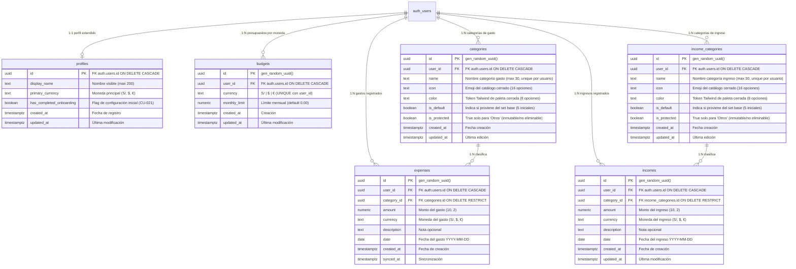
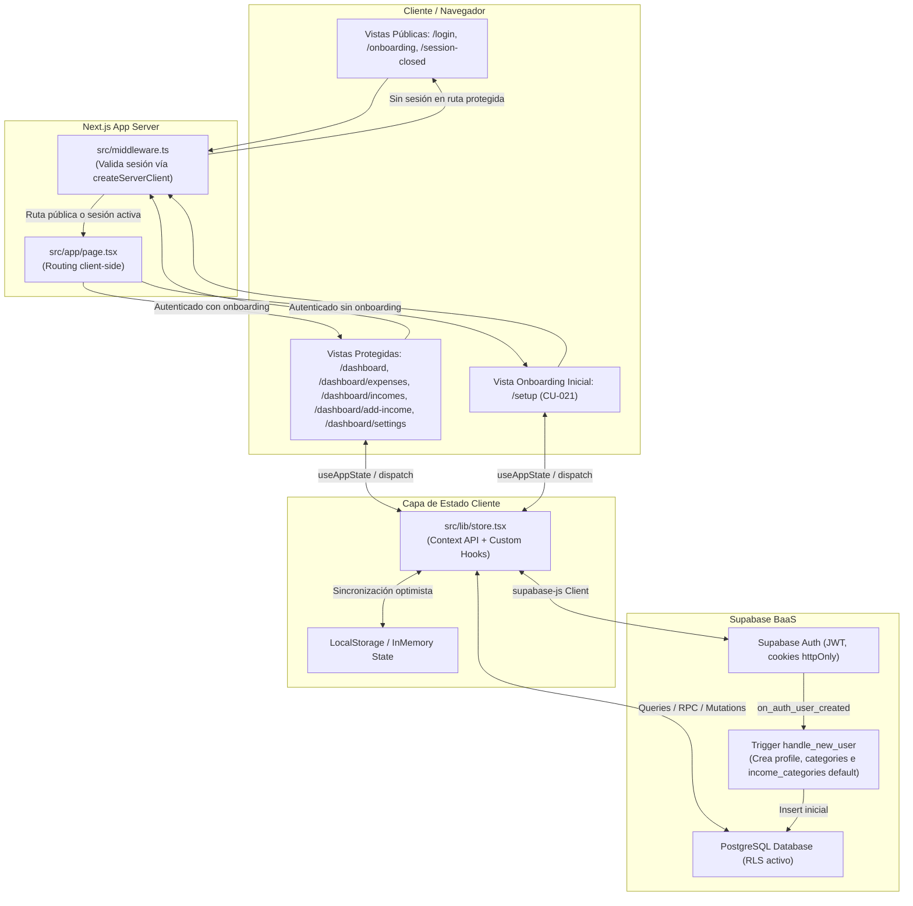
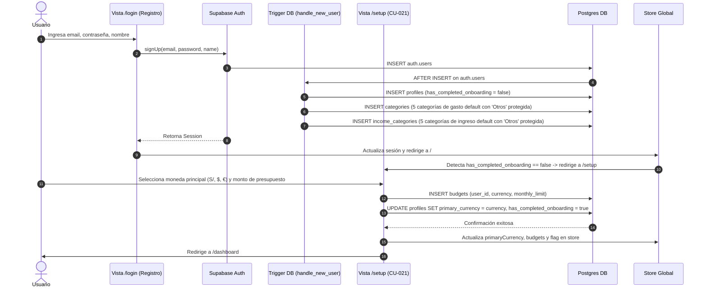
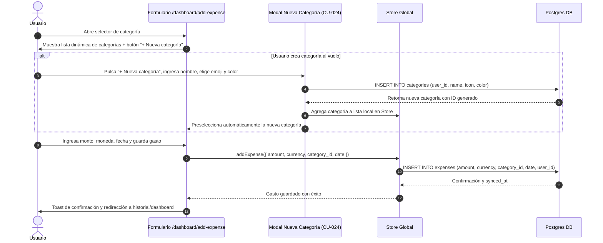
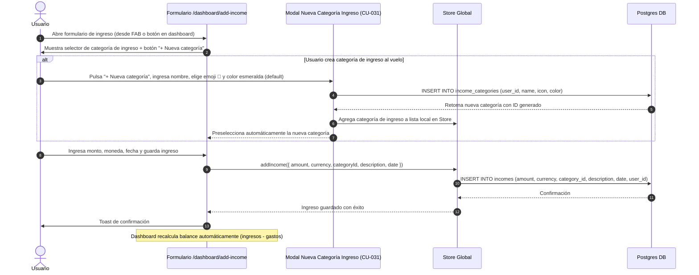
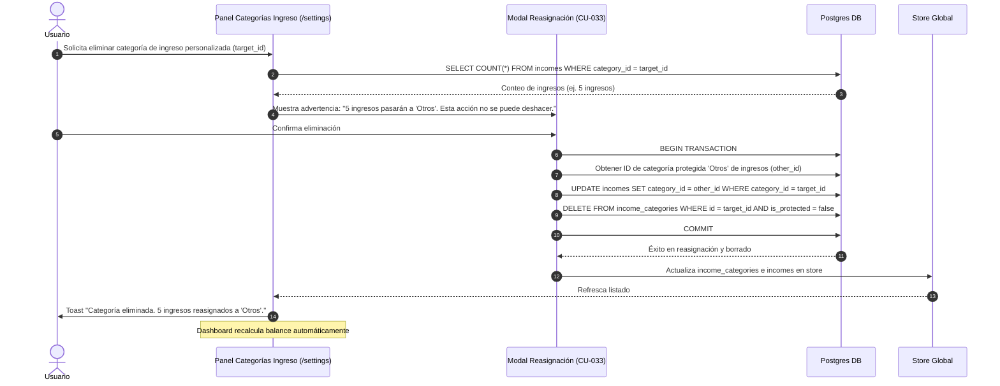
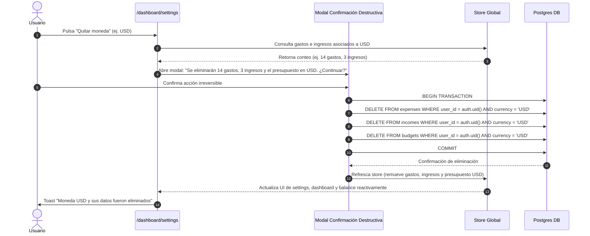
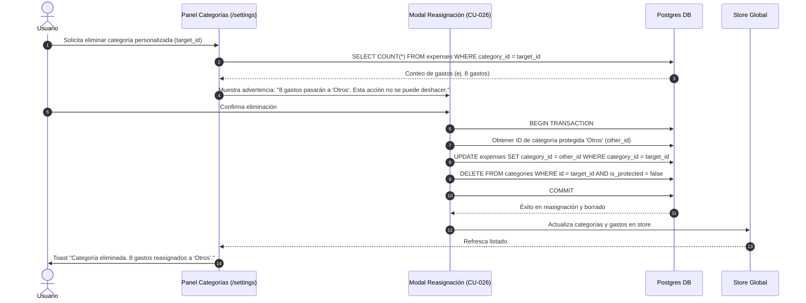

# Especificación de Arquitectura Técnica y Diagramación — Paltazo

> **Generado con:** Skill `archify`
> **Fecha:** 30 oct 2026
> **Estado:** Aprobado para implementación previa a programación
> **Fuentes de verdad funcional:** `docs/use-case/` (34 Casos de Uso, 27 Historias de Usuario, Obsidian Canvas y `HANDOFF_AUTH_REVIEW.md`).

---

## 1. Diagrama de Entidad-Relación (ERD)

Este modelo refleja la persistencia en Supabase PostgreSQL. Incorpora tablas para gestión de gastos (`expenses` + `categories`) e ingresos (`incomes` + `income_categories`), el flag de onboarding en `profiles`, y la eliminación del `CHECK` estático en `expenses.category`.



### Reglas y Políticas de Seguridad en Datos (RLS)
* **Aislamiento por usuario:** Todas las tablas (`profiles`, `budgets`, `categories`, `income_categories`, `expenses`, `incomes`) tienen `ENABLE ROW LEVEL SECURITY` con políticas `FOR ALL USING (auth.uid() = user_id)` (o `auth.uid() = id` en `profiles`).
* **Protección de 'Otros':** Política en `categories` e `income_categories` bloquea `DELETE` y `UPDATE` cuando `is_protected = true`.
* **Eliminación en cascada:**
  * Si se quita una moneda (`CU-023`): Se eliminan en transacción atómica los `budgets`, `expenses` e `incomes` asociados a esa moneda para ese `user_id`.
  * Si se elimina una categoría de gasto (`CU-026`): Previamente se reasignan los `expenses` hacia el `category_id` de 'Otros' del usuario (`UPDATE expenses SET category_id = other_cat_id WHERE category_id = target_cat_id`).
  * Si se elimina una categoría de ingreso (`CU-033`): Previamente se reasignan los `incomes` hacia el `category_id` de 'Otros' de ingresos del usuario (`UPDATE incomes SET category_id = other_income_cat_id WHERE category_id = target_cat_id`).

---

## 2. Diagrama de Arquitectura de Componentes y Flujo de Datos



---

## 3. Diagramas de Secuencia para Flujos Críticos

### Flujo 1: Registro + Onboarding Inicial (CU-002 -> CU-021)
El usuario se registra, el trigger crea su perfil base, las 5 categorías de gasto default (incluyendo 'Otros' protegida) y las 5 categorías de ingreso default (incluyendo 'Otros' de ingresos protegida). El usuario es guiado a seleccionar su moneda principal y presupuesto mensual antes de acceder al dashboard.



---

### Flujo 2: Registro de Gasto con Categoría Dinámica y Modal '+ Nueva' (CU-008, CU-024)



---

### Flujo 3: Registro de Ingreso con Categoría Dinámica y Modal '+ Nueva' (CU-027, CU-031)
Flujo paralelo al registro de gasto (CU-008). El usuario registra ingresos esporádicos (sueldo, devoluciones, ventas) con categorías independientes de las de gasto.



---

### Flujo 4: Eliminación de Categoría de Ingreso con Reasignación a "Otros" (CU-033)
Garantiza que ningún ingreso quede huérfano. Paralelo al Flujo 4 (CU-026) pero opera sobre `incomes` e `income_categories`.



---

### Flujo 6: Eliminación de Moneda Secundaria con Purga de Datos (CU-023)
Acción destructiva irreversible. Se alerta con la cantidad de gastos e ingresos afectados antes de borrar.



---

### Flujo 7: Eliminación de Categoría con Reasignación Automática a "Otros" (CU-026)
Garantiza que ningún gasto quede huérfano y previene la pérdida de historial financiero.



---

### Flujo 8: Cierre de Sesión Global y Redirección a `/session-closed` (CU-005)
Resolución de la brecha P0: Manejo estricto de errores de Supabase, invalidación de tokens en todos los dispositivos y pantalla de salida dedicada.

```mermaid
sequenceDiagram
    autonumber
    actor U as Usuario
    participant UI as Sidebar / Settings (Logout CTA)
    participant St as Store Global (store.logout)
    participant S as Supabase Client (signOut scope: global)
    participant SC as Pantalla /session-closed

    U->>UI: Pulsa "Cerrar sesión"
    UI->>St: Invoca store.logout()
    St->>S: signOut({ scope: 'global' })
    alt Fallo de red o error en Supabase
        S-->>St: Retorna { error }
        St-->>UI: Muestra Toast "Error al cerrar sesión, intenta nuevamente"
        Note over UI: Sesión local se preserva; NO se redirige
    else Éxito en Supabase
        S-->>St: Retorna { error: null }
        St->>St: Limpia estado (userId = null, expenses = [], budgets = [])
        St->>UI: Notifica cierre exitoso
        UI->>SC: Redirige a /session-closed
        SC->>U: Muestra "Sesión cerrada correctamente" + Botón "Volver a ingresar"
        U->>SC: Clic en "Volver a ingresar" -> Redirige a /login
    end
```

---

## 4. Matriz de Deuda Técnica y Plan de Implementación por Fases

| ID | Prioridad | Componente Afectado | Brecha / Tarea | Solución Arquitectónica |
| :--- | :--- | :--- | :--- | :--- |
| **P0-1** | **Crítica (P0)** | `src/lib/store.tsx`<br>`src/components/ui/Sidebar.tsx`<br>`src/app/dashboard/settings/page.tsx` | Logout ignora error de Supabase y redirige incondicionalmente a `/onboarding`. | Capturar `{ error }` de `signOut()`. Si hay error, mostrar Toast y no limpiar sesión. Si es exitoso, limpiar store y redirigir a `/session-closed`. |
| **P0-2** | **Crítica (P0)** | Rutas públicas / Páginas | Inexistencia de pantalla dedicada post-logout. | Crear ruta pública `src/app/session-closed/page.tsx` con mensaje de confirmación y enlace a `/login`. |
| **P1-1** | **Alta (P1)** | `src/app/dashboard/page.tsx:48-50` | BUG-001: Porcentaje de presupuesto con tope en 100 (`Math.min`). Nivel `exceeded` inalcanzable. | Eliminar `Math.min(..., 100)` en el cálculo de `percentage`. Mantener `exceeded` cuando `percentage >= 101%`. |
| **P1-2** | **Alta (P1)** | `supabase/migrations/` | `expenses.category` tiene `CHECK` estático restrictivo. Falta tabla `categories`. | Crear migración con tabla `categories`, foreign key en `expenses` y eliminar el constraint `CHECK`. |
| **P1-3** | **Alta (P1)** | `supabase/migrations/` | Trigger `handle_new_user` asigna moneda y presupuesto fijo de S/ 1000. | Actualizar trigger: crear solo `profiles` (`has_completed_onboarding = false`) y categorías por defecto. |
| **P1-4** | **Alta (P1)** | Frontend Onboarding | Inexistencia de flujo post-registro de selección de moneda/presupuesto. | Crear pantalla `/setup` (CU-021) y middleware check para redirigir si `has_completed_onboarding = false`. |
| **P2-1** | **Media (P2)** | `supabase/migrations/` | Módulo de ingresos: faltan tablas `income_categories` e `incomes`. | Crear migración con tabla `income_categories` (RLS, seed 5 categorías default incluyendo 'Otros' protegida) y tabla `incomes` (FK a `income_categories.id`). |
| **P2-2** | **Media (P2)** | `supabase/migrations/` | Trigger `handle_new_user` no crea categorías de ingreso. | Actualizar trigger: además de crear `categories`, insertar 5 `income_categories` default (💼 Sueldo, 💡 Freelance, 🎁 Devolución, 🛒 Venta, 📦 Otros protegido). |
| **P2-3** | **Media (P2)** | `supabase/migrations/` | Eliminación de moneda (`CU-023`) no purga ingresos. | Actualizar lógica de eliminación de moneda para incluir `DELETE FROM incomes` en la transacción atómica. |
| **P2-4** | **Media (P2)** | `src/types/index.ts` | Faltan interfaces `Income` e `IncomeCategory`. | Agregar interfaces TypeScript para ingresos y categorías de ingreso (análogas a `Expense` y `Category`). |
| **P2-5** | **Media (P2)** | `src/lib/store.tsx` | Estado global no maneja ingresos. | Extender store: agregar `incomes: Income[]`, `incomeCategories: IncomeCategory[]`, métodos `addIncome()`, `updateIncome()`, `deleteIncome()`, `addIncomeCategory()`, `updateIncomeCategory()`, `deleteIncomeCategory()`. |
| **P2-6** | **Media (P2)** | `src/lib/supabase/repositories.ts` | Faltan queries para ingresos. | Agregar funciones: `getIncomes()`, `addIncome()`, `updateIncome()`, `deleteIncome()`, `getIncomeCategories()`, `addIncomeCategory()`, `updateIncomeCategory()`, `deleteIncomeCategory()` (con reasignación a 'Otros'). |
| **P2-7** | **Media (P2)** | `src/app/dashboard/add-income/page.tsx` | Pantalla de registro de ingresos no existe. | Crear formulario análogo a `add-expense` (CU-027): selector de categorías de ingreso, monto, moneda, fecha, descripción. Sin presets rápidos. Botón `+ Nueva categoría` inline (CU-031). |
| **P2-8** | **Media (P2)** | `src/app/dashboard/incomes/page.tsx` | Vista de listado de ingresos no existe. | Crear pantalla análoga a `expenses` (CU-030): tabla desktop, cards mobile, agrupado por fecha, edición inline (CU-028), eliminación con confirmación (CU-029). |
| **P2-9** | **Media (P2)** | `src/app/dashboard/page.tsx` | Dashboard no muestra balance real. | Agregar sección "💵 Balance del mes" antes de "Presupuestos mensuales" (CU-034): sub-cards por moneda con total ingresado, gastado y balance neto. |
| **P2-10** | **Media (P2)** | `src/app/dashboard/settings/page.tsx` | Settings no gestiona categorías de ingreso. | Agregar sección "Categorías de ingreso" (paralela a "Categorías de gasto"): CRUD completo (CU-031, CU-032, CU-033) con modal de reasignación a 'Otros'. |
| **P2-11** | **Media (P2)** | FAB y botones de navegación | No hay acceso rápido a ingresos. | Agregar opción `+ Ingreso` en FAB del dashboard. Agregar botón "Ver todos →" en sección Balance que navega a `/dashboard/incomes`. No modificar BottomNav. |

---

## 5. Plan de Ejecución por Fases

```
Fase 1: Corrección de Brechas Críticas Existentes (P0 & P1) ✅ COMPLETADA
├── 1.1 Corregir logout en store.tsx y callers (Sidebar & Settings)
├── 1.2 Crear página /session-closed y agregar a publicPaths en middleware.ts
└── 1.3 Resolver BUG-001 removiendo el cap de 100% en dashboard/page.tsx

Fase 2: Base de Datos y Migraciones SQL (Supabase) ✅ COMPLETADA
├── 2.1 Nueva migración: crear tabla categories (con RLS y seed inicial de categorías)
├── 2.2 Alter table expenses: agregar category_id UUID, migrar datos y remover CHECK
├── 2.3 Alter table profiles: agregar primary_currency y has_completed_onboarding
└── 2.4 Actualizar función trigger handle_new_user (eliminar presupuesto default S/ 1000)

Fase 3: Contratos TypeScript y Estado Global ✅ COMPLETADA
├── 3.1 Actualizar src/types/index.ts: interface Category y dinamizar Expense.categoryId
└── 3.2 Extender src/lib/store.tsx: soporte para CRUD de categorías y validación de onboarding

Fase 4: Componentes de UI y Flujos Funcionales ✅ COMPLETADA
├── 4.1 Pantalla de Configuración Inicial /setup (CU-021)
├── 4.2 Gestión de Monedas en Settings (CU-022 y CU-023 con purga destructiva)
├── 4.3 CRUD de Categorías en Settings y Modal rápido en Add Expense (CU-024, CU-025, CU-026)
└── 4.4 Pruebas end-to-end de flujos y actualización final de documentación

Fase 5: Módulo de Ingresos (PROPUESTO — pendiente de implementación)
├── 5.1 Migración DB: crear tablas income_categories e incomes (P2-1, P2-2)
│   ├── Crear tabla income_categories (RLS + seed 5 categorías default)
│   ├── Crear tabla incomes (FK a income_categories.id)
│   ├── Actualizar trigger handle_new_user para crear income_categories default
│   └── Actualizar lógica de eliminación de moneda para purgar incomes (P2-3)
├── 5.2 Contratos TypeScript y Estado Global (P2-4, P2-5)
│   ├── Agregar interfaces Income e IncomeCategory en src/types/index.ts
│   ├── Extender store.tsx: incomes, incomeCategories, CRUD methods
│   └── Agregar queries en repositories.ts (P2-6)
├── 5.3 UI de Registro y Listado de Ingresos (P2-7, P2-8)
│   ├── Crear /dashboard/add-income (formulario análogo a add-expense, sin presets)
│   ├── Crear /dashboard/incomes (listado análogo a expenses, edición inline)
│   └── Agregar acceso rápido en FAB (+ Ingreso)
├── 5.4 UI de Gestión de Categorías de Ingreso (P2-10)
│   ├── Agregar sección "Categorías de ingreso" en /dashboard/settings
│   ├── CRUD completo con modal de reasignación a 'Otros'
│   └── Botón "+ Nueva categoría" inline en selector de add-income
├── 5.5 Dashboard: Balance Real (P2-9)
│   ├── Agregar sección "💵 Balance del mes" antes de "Presupuestos mensuales"
│   ├── Sub-cards por moneda: total ingresado, gastado, balance neto
│   └── Botón "Ver todos →" que navega a /dashboard/incomes
└── 5.6 Pruebas y Documentación
    ├── Pruebas end-to-end de flujos de ingresos
    ├── Actualizar CHECKPOINT con estado de implementación
    └── Actualizar graphify-out
```

